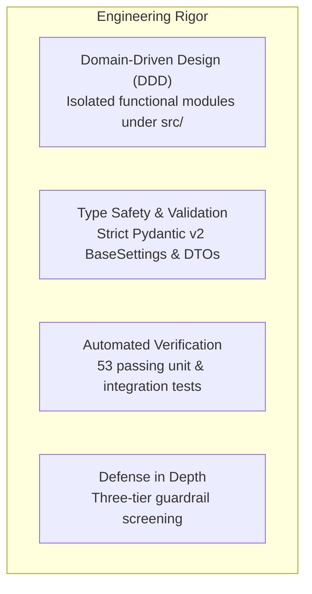
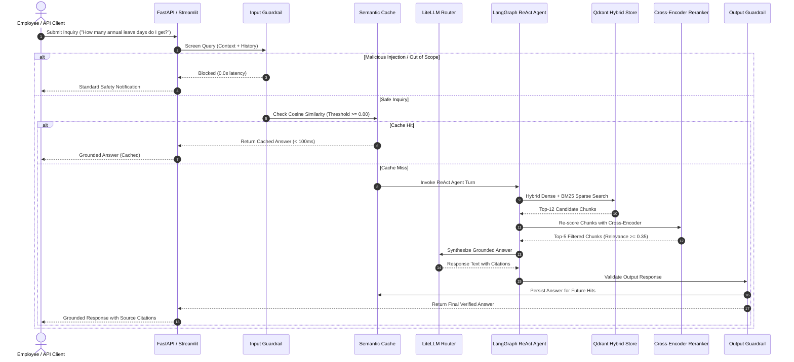

# System Overview: Enterprise HR Policy RAG Assistant

## 1. Executive Summary

The **HR Policy RAG Assistant with Enterprise AI Security** is a cloud-native, production-grade Retrieval-Augmented Generation (RAG) system engineered for automated employee policy resolution in corporate environments. The architecture bridges unstructured corporate policies with conversational AI while enforcing defense-in-depth security, strict domain fencing, hybrid retrieval precision, and sub-second latency.

The system is constructed to solve real-world enterprise RAG challenges:
- **Retrieval Precision**: Eliminating false-positive document retrieval amidst corporate data noise through hybrid sparse-dense fusion and Cross-Encoder re-ranking.
- **AI Safety & Adversarial Resilience**: Intercepting jailbreaks, prompt injections, and scope-escape attacks at the boundary using Google Model Armor and multi-layer input/output guardrails.
- **Operational Efficiency & Low Latency**: Bypassing heavy downstream LLM inference for high-frequency queries using local ONNX-accelerated semantic caching.
- **Enterprise Access Governance**: Restricting access to authorized personnel via Google OAuth 2.0 and email domain whitelisting.
- **Dual Interface Delivery**: Serving end-users through an interactive Streamlit UI while providing programmatic integration via a high-throughput FastAPI REST API.

---

## 2. Production Engineering Standards

The codebase adheres strictly to enterprise software engineering standards:

### Key Architectural Tenets:
1. **Domain-Driven Design (DDD)**: Functional decoupling across dedicated domain packages (`src/ingestion`, `src/retrieval`, `src/security`, `src/agent`, `src/evaluation`, `src/services`, `src/api`).
2. **Strict Configuration Validation**: Dynamic parsing and validation of environment parameters via `pydantic-settings`, preventing unvalidated runtime initialization.
3. **Zero-Cloud-Cost Local Development**: Native ability to execute all vector operations, embeddings, and re-ranking locally via Qdrant Cloud Free Tier and ONNX FastEmbed without recurring cloud bills.
4. **Idempotent Ingestion**: Point IDs deterministically calculated via `UUID5` hashes of document content, preventing chunk duplication across repeated ingestion runs.
5. **Full Observability**: Comprehensive tracing of model tokens, latency, and tool invocations via LangSmith.

---

## 3. High-Level System Workflow

The end-to-end request lifecycle progresses through distinct security and retrieval checkpoints:

---

## 4. Key Performance Indicators (KPIs)

| Metric | Target Specification | Achieved Production Benchmark |
| :--- | :--- | :--- |
| **Cache Hit Latency** | $< 200\text{ ms}$ | **$50\text{ ms} - 100\text{ ms}$** (via local ONNX FastEmbed) |
| **Cold LLM Generation Latency** | $< 8.0\text{ s}$ | **$6.0\text{ s} - 7.0\text{ s}$** (Gemini 3.5 Flash-Lite) |
| **Jailbreak Interception Latency** | $< 50\text{ ms}$ | **$0.0\text{ s}$** (Instant boundary rejection) |
| **Test Suite Coverage** | $100\%$ critical path pass rate | **53 / 53 tests passing (failures=0, errors=0)** |
| **Ingestion Idempotency** | $0\%$ duplicate records | **Verified via UUID5 deterministic hashing** |
