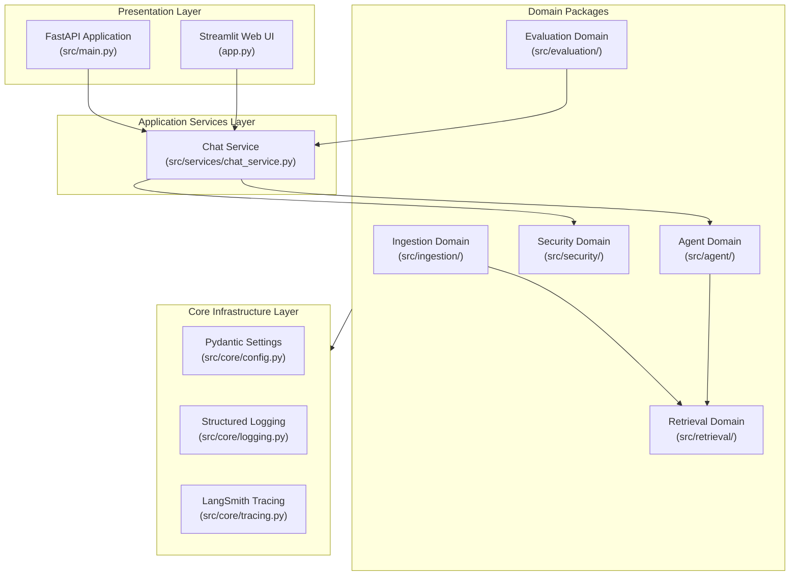

# System Architecture: Domain-Driven Modular Layout

## 1. Architectural Philosophy

The architecture of the HR Policy Assistant is designed according to **Clean Architecture** and **Domain-Driven Design (DDD)** principles. The codebase decouples persistence, external APIs, and presentation frameworks from the foundational business logic.



---

## 2. Directory Layout & Package Taxonomy

```text
projects/01-rag-applications/01-hr-policy-rag-assistant/
├── src/                                  # Pure Domain-Driven Source Tree
│   ├── main.py                           # FastAPI Application Factory & Lifespan
│   │
│   ├── core/                             # Cross-Cutting Concerns
│   │   ├── config.py                     # Strict BaseSettings configuration
│   │   ├── logging.py                    # Cloud-ready structured logger
│   │   └── tracing.py                    # LangSmith telemetry hooks
│   │
│   ├── schemas/                          # Data Transfer Objects (DTOs)
│   │   ├── chat.py                       # ChatRequest, Citation, ChatResponse
│   │   └── health.py                     # ComponentStatus, HealthResponse
│   │
│   ├── api/                              # REST Interface & Dependency Providers
│   │   ├── deps.py                       # Singleton assistant dependency
│   │   └── v1/
│   │       ├── router.py                 # Aggregated v1 endpoints
│   │       └── endpoints/
│   │           ├── chat.py               # POST /api/v1/chat endpoint
│   │           └── health.py             # GET /health & GET /api/v1/health probe
│   │
│   ├── ingestion/                        # Document ETL Subsystem
│   │   ├── processor.py                  # Binary parser (.pdf, .docx, .pptx, .txt)
│   │   ├── document_loader.py            # Local & Cloud storage loader
│   │   ├── splitter.py                   # Recursive character chunking
│   │   └── ingestion.py                  # Dual-pipeline batch ingestion orchestrator
│   │
│   ├── retrieval/                        # Vector Store & Search Subsystem
│   │   ├── embeddings.py                 # FastEmbed ONNX & Jina embedding models
│   │   ├── vector_store.py               # Qdrant client, hybrid index, healthchecks
│   │   └── reranker.py                   # High-precision Cross-Encoder re-ranker
│   │
│   ├── security/                         # AI Boundary Defense Subsystem
│   │   ├── guardrails.py                 # Multi-layer safety guardrails
│   │   └── semantic_cache.py             # Vector similarity semantic cache
│   │
│   ├── agent/                            # Reasoning & LLM Gateway Subsystem
│   │   ├── agent.py                      # LangGraph ReAct state machine
│   │   ├── tools.py                      # Scoped search tool ('search_hr_policy')
│   │   ├── prompts.py                    # System prompts & operational boundaries
│   │   ├── thread_memory.py              # Multi-turn conversation thread memory
│   │   ├── llm.py                        # LiteLLM router & failover provider
│   │   └── studio_graph.py               # LangGraph Studio export entrypoint
│   │
│   ├── evaluation/                       # Automated Quality Assurance Subsystem
│   │   └── evaluation.py                 # RAG Triad evaluators & LLM-as-a-Judge
│   │
│   └── services/                         # Application Services Layer
│       ├── chat_service.py               # Secure turn execution flow (ask)
│       └── pipeline.py                   # Backward compatibility alias
│
├── tests/                                # 53 Automated Tests
├── app.py                                # Streamlit Web UI with Google OAuth
├── ingest.py                             # Ingestion CLI Entrypoint
├── evaluate.py                           # Evaluation CLI Entrypoint
├── Dockerfile                            # Production Container Definition
└── docker-compose.yml                    # Microservice Orchestration
```

---

## 3. Communication Patterns Across Boundaries

1. **Presentation to Service**:
   - `app.py` and `src/api/v1/endpoints/chat.py` communicate exclusively with `src/services/chat_service.py` via `ask()` or `build_hr_assistant()`. Neither interface directly accesses the vector store or raw LLMs.
2. **Service to Security**:
   - `chat_service.py` executes safety screenings through `check_input()` before delegating work to the agent, and verifies generated content with `check_output()` before committing it to cache or returning it to users.
3. **Agent to Retrieval**:
   - The LangGraph agent interacts with Qdrant exclusively via the LangChain tool interface (`search_hr_policy`), which encapsulates dense/sparse search, candidate scoring, and re-ranking.
4. **Data Contract Compliance**:
   - All REST requests and responses conform to strict Pydantic models defined in `src/schemas/`, ensuring programmatic safety for external consumers.
