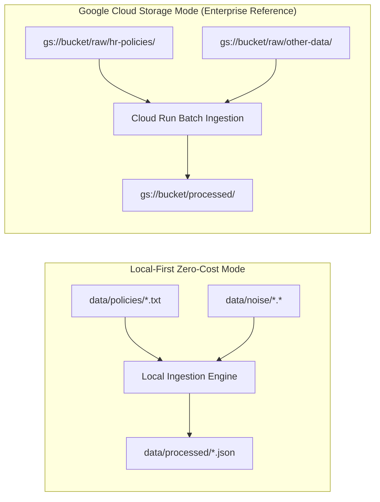

# Data Strategy: Enterprise Corpus & Distractor Noise Architecture

## 1. Corpus Design Principles

A production-grade RAG system must be tested not only on clean, ideal documents, but also against realistic corporate data chaos. The data strategy implements a **Dual-Corpus Pattern**:
1. **Clean HR Policies**: 10 official corporate policy documents representing true ground truth.
2. **Distractor Noise Documents**: 8 synthetic enterprise files across mixed binary formats (`.pdf`, `.docx`, `.pptx`, `.txt`) containing finance, IT, and sales data designed to test retrieval filtering and guardrail boundaries.

---

## 2. Document Inventory

```text
data/
├── policies/                         # Official HR Policy Documents
│   ├── leave_policy.txt              # Paid annual leave, sick leave, carry forward rules
│   ├── remote_work_policy.txt        # Work from home eligibility, equipment stipends
│   ├── probation_policy.txt          # Standard 3-month probation, extension guidelines
│   ├── notice_period_policy.txt      # Resignation terms, garden leave, notice waivers
│   ├── reimbursement_policy.txt      # Business travel, internet, certification claims
│   ├── code_of_conduct.txt           # Workplace ethics, conflict of interest, harassment
│   ├── holidays_policy.txt           # Official public holidays, floating holidays
│   ├── maternity_paternity_leave.txt # Parental leave duration and paid salary terms
│   ├── travel_expense_policy.txt     # Per diem allowances, flight booking tiers
│   └── exit_process_policy.txt       # Asset return, final settlement, handover timeline
│
├── noise/                            # Enterprise Distractor Files (Adversarial Data)
│   ├── q3_financial_report.pdf       # Non-HR corporate financial earnings and margins
│   ├── vendor_contract_sla.docx      # Third-party procurement service level agreements
│   ├── product_roadmap_2025.pptx     # Engineering feature releases and milestones
│   ├── it_security_handbook.pdf      # Network firewalls, VPN, and IAM protocols
│   ├── cloud_migration_guide.docx    # Infrastructure DevOps deployment instructions
│   ├── sales_quarterly_targets.pptx  # Sales quotas, commission structures, and deals
│   ├── api_gateway_architecture.pdf  # Technical backend microservice architecture
│   └── facility_guidelines.txt       # Office parking rules and badge access procedures
│
└── processed/                        # Intermediate JSON Storage (Parse-Once-to-JSON)
    ├── hr-policies/                  # Standardized parsed JSON policy chunks
    └── other-data/                   # Standardized parsed JSON noise chunks
```

---

## 3. Storage Hierarchy & Enterprise GCS Alignment

The ingestion pipeline supports dual execution modes:



### Storage Zone Definitions:
1. **Raw Zone (`raw/`)**: Holds unmodified binary and text files directly uploaded by business units.
2. **Processed Zone (`processed/`)**: Contains structured JSON records parsed by `processor.py`. Downstream chunking and embedding operations read directly from this layer, completely decoupling parsing latency from vector indexing.
