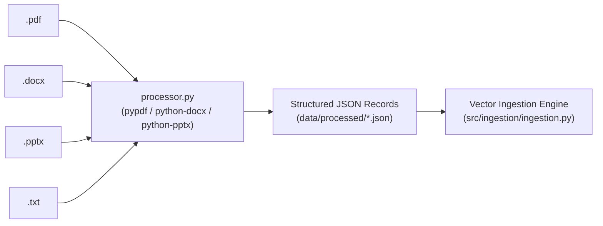

# Document Processing: Parse-Once-to-JSON Pattern & Binary Parsers

## 1. Architectural Motivation

In high-throughput enterprise pipelines, parsing complex binary files (such as multi-page PDFs, complex Word documents with tables, and PowerPoint presentations) directly during vector ingestion creates severe compute bottlenecks and slows down CI/CD testing.

To solve this, the pipeline adopts the **Parse-Once-to-JSON Pattern**:
1. Raw binaries are read by specialized parsers inside `src/ingestion/processor.py`.
2. Extracted text and metadata are saved as structured, normalized JSON records in `data/processed/`.
3. Downstream vector embedding and chunking operations read purely from intermediate JSON files, bypassing binary parsing entirely.



---

## 2. Multi-Format Binary Parsers

The module `src/ingestion/processor.py` implements dedicated extractors for each document type:

| File Extension | Parsing Engine | Extraction Strategy |
| :--- | :--- | :--- |
| `.pdf` | `pypdf.PdfReader` | Iterates across pages, extracts text blocks, strips zero-width spaces, and normalizes line breaks. |
| `.docx` | `docx.Document` | Traverses paragraphs and tables, aggregating cells into structured tab-separated rows. |
| `.pptx` | `pptx.Presentation` | Iterates across slides and text shapes, preserving slide titles and bullet-point hierarchies. |
| `.txt` | Native Python I/O | Reads raw UTF-8 text with BOM detection and whitespace normalization. |

---

## 3. Standardized Intermediate JSON Schema

Every parsed document is committed to disk according to a uniform JSON payload:

```json
{
  "source_file": "leave_policy.txt",
  "document_category": "Leave",
  "total_characters": 3420,
  "extraction_timestamp": "2026-11-23T08:00:00Z",
  "content": "Full extracted plain text payload without binary artifacts..."
}
```

This ensures downstream components remain completely agnostic to original source file formats.
