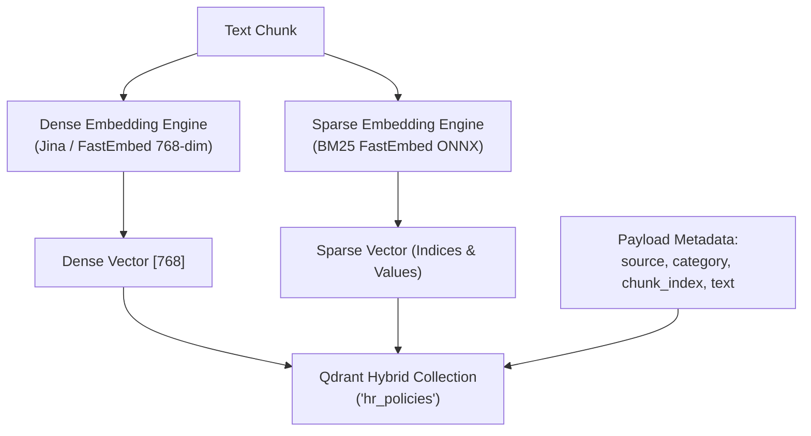

# Chunking & Vector Store: Stable UUID5 Determinism & Hybrid Indexing

## 1. Chunking Strategy & Overlap Optimization

Text chunking is managed by `src/ingestion/splitter.py` using `RecursiveCharacterTextSplitter`.

### Splitting Hyperparameters:
- **Chunk Size ($C_{size}$)**: $500$ characters.
- **Chunk Overlap ($C_{overlap}$)**: $60$ characters.
- **Separators**: `["\n\n", "\n", ". ", " ", ""]`.

$$
\text{Effective Context Window} = C_{size} - C_{overlap} = 500 - 60 = 440 \text{ unique chars/chunk}
$$

The $60$-character overlap ensures that policy terms, conditional clauses, and definitions spanning split boundaries are not fragmented.

---

## 2. Deterministic Point IDs (UUID5 Architecture)

In naïve vector stores, randomly generated UUIDs (`uuid.uuid4()`) cause repeated ingestion runs to create duplicate vectors, artificially inflating database size and degrading search relevance.

The system solves this by computing a deterministic **UUID5** hash derived from the source filename and chunk index:

```python
import uuid

NAMESPACE_HR = uuid.UUID("6ba7b810-9dad-11d1-80b4-00c04fd430c8")

def compute_chunk_id(source_file: str, chunk_index: int) -> str:
    """Generate deterministic, idempotent UUID5 based on file and chunk index."""
    identifier = f"{source_file}::chunk::{chunk_index}"
    return str(uuid.uuid5(NAMESPACE_HR, identifier))
```

### Benefits:
- **Idempotency**: Running `python ingest.py --force` 100 times results in the exact same vector IDs, executing clean upserts without duplicate records.
- **Zero Drift**: Deleting and re-indexing retains stable cross-references.

---

## 3. Hybrid Vector Storage in Qdrant Cloud

The vector store layer (`src/retrieval/vector_store.py`) interfaces with **Qdrant Cloud** using a true **Hybrid Storage Configuration**:



### Collection Vector Configuration:
```python
client.create_collection(
    collection_name="hr_policies",
    vectors_config={
        "dense": models.VectorParams(size=768, distance=models.Distance.COSINE),
    },
    sparse_vectors_config={
        "sparse": models.SparseVectorParams(
            index=models.SparseIndexParams(on_disk=False)
        )
    },
)
```

### Fast Payload Indexing:
Payload indices are created for `category` and `source` fields, enabling instantaneous pre-filtering and exact metadata queries:
```python
client.create_payload_index(
    collection_name="hr_policies",
    field_name="category",
    field_schema=models.PayloadSchemaType.KEYWORD,
)
```
