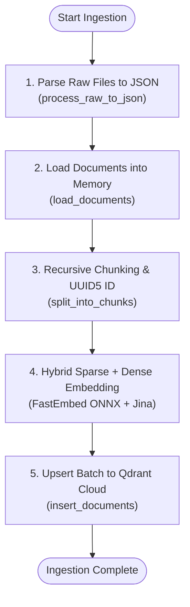

# Ingestion Pipeline: SOLID Ingestion Orchestration & CLI Automation

## 1. Pipeline Architecture & SOLID Principles

The batch ingestion subsystem (`src/ingestion/ingestion.py`) orchestrates the loading, chunking, embedding, and indexing of corporate documents. The pipeline adheres strictly to **SOLID design principles**:

- **Single Responsibility Principle (SRP)**: Parsing, chunking, vector generation, and Qdrant indexing are encapsulated in distinct classes and functions.
- **Open/Closed Principle (OCP)**: New file formats (e.g. `.html` or `.markdown`) can be registered in `processor.py` without modifying downstream vector indexing logic.
- **Dependency Inversion Principle (DIP)**: Ingestion modules depend on high-level embeddings and vector store abstractions rather than hardcoded client instances.



---

## 2. Dual Pipeline Support: Clean vs. Noisy Corpus

To facilitate red teaming and adversarial robustness testing, the ingestion engine provides two isolated pipelines:

1. **Clean Production Pipeline (`ingest_hr_policies`)**:
   - Source: `data/policies/*.txt`
   - Destination Collection: `hr_policies`
   - Target Use Case: Production employee query serving.
2. **Mixed Stress-Testing Pipeline (`ingest_noisy_corpus`)**:
   - Source: `data/policies/*.txt` + `data/noise/*.*` (finance, contracts, slides)
   - Destination Collection: `hr_policies_noisy_demo`
   - Target Use Case: Adversarial testing to ensure non-HR documents are strictly rejected by scope guardrails and re-rankers.

---

## 3. Command-Line Interface (`ingest.py`)

The pipeline is driven via `ingest.py` supporting granular flags:

```bash
# Ingest both clean HR policies and noisy test corpus
python ingest.py

# Force re-ingestion and overwrite existing collections
python ingest.py --force

# Ingest only official HR policy documents
python ingest.py --hr-only

# Ingest only synthetic noisy distractor files
python ingest.py --noisy-only
```

### Automated Ingestion Logs:
```text
[INFO] Processing raw files to JSON in data/processed/...
[INFO] Loading parsed JSON policy documents...
[INFO] Split into 48 policy chunks.
[INFO] Computing dense and sparse embeddings via FastEmbed...
[INFO] Upserting 48 points into Qdrant collection 'hr_policies'...
[INFO] Ingestion completed successfully in 3.42s.
```
