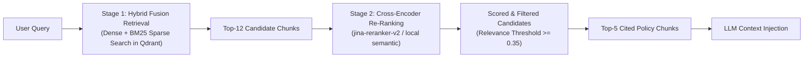
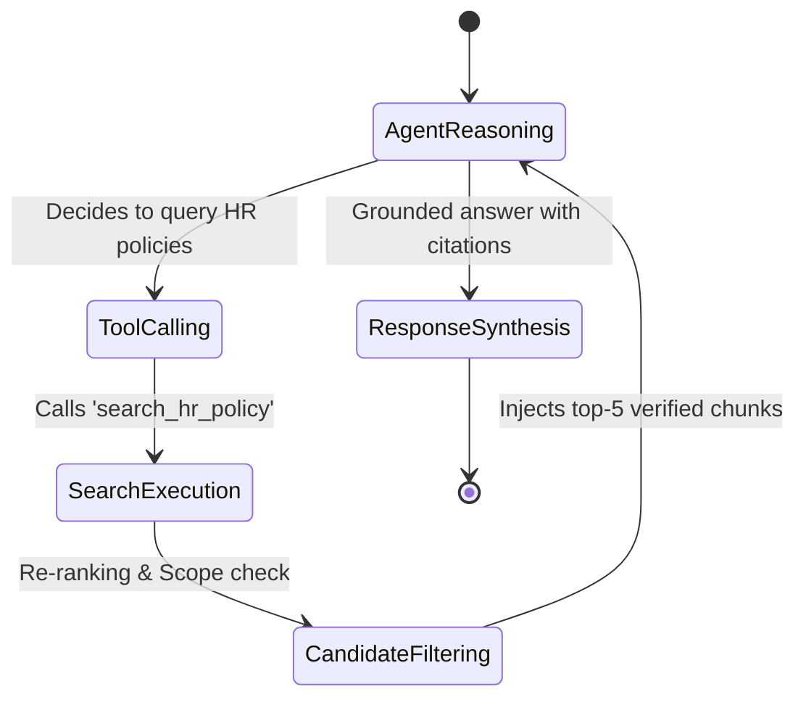

# Hybrid Retrieval & Agent Pipeline: Two-Stage Search & ReAct Reasoning

## 1. Two-Stage Retrieval Architecture

Single-stage vector retrieval often fails in enterprise search because lexical queries (e.g. specific policy numbers or acronyms) are missed by dense embeddings, while dense semantic queries are missed by pure keyword matchers. Furthermore, false-positive chunks can easily mislead the LLM.

The system implements a **Two-Stage Retrieval Pipeline**:

### Retrieval Parameters:
- **Candidate Pool ($K_{candidate}$)**: $12$ candidates retrieved in Stage 1 to cast a wide net.
- **Final Cited Chunks ($K_{final}$)**: Top $5$ chunks passed to the LLM context.
- **Relevance Cutoff ($\theta_{rel}$)**: $0.35$. Any chunk scoring below this threshold is dropped, preventing hallucinated grounding on irrelevant noise.

---

## 2. Cross-Encoder Re-Ranking Mathematical Formulation

Unlike Bi-Encoders that compute query and passage embeddings independently:

$$
\text{Score}_{\text{bi-encoder}} = \cos(\mathbf{e}_q, \mathbf{e}_p) = \frac{\mathbf{e}_q \cdot \mathbf{e}_p}{\|\mathbf{e}_q\| \|\mathbf{e}_p\|}
$$

The Cross-Encoder processes the query $q$ and document chunk $p$ simultaneously with full cross-attention across all tokens:

$$
\text{Score}_{\text{cross-encoder}} = \sigma\left( \mathbf{W} \cdot \text{Transformer}([CLS] \circ q \circ [SEP] \circ p) \right)
$$

This captures complex semantic interactions, negative qualifiers, and specific policy conditions that Bi-Encoders miss.

---

## 3. LangGraph ReAct Agent Implementation

The reasoning agent (`src/agent/agent.py`) is implemented using **LangGraph** configured with an autonomous ReAct loop:

### Agent Tool Interface (`src/agent/tools.py`):
The search tool `search_hr_policy` is registered as a LangChain tool with strict documentation instructing the agent to always cite official source document filenames (e.g. `(Source: leave_policy.txt)`).
