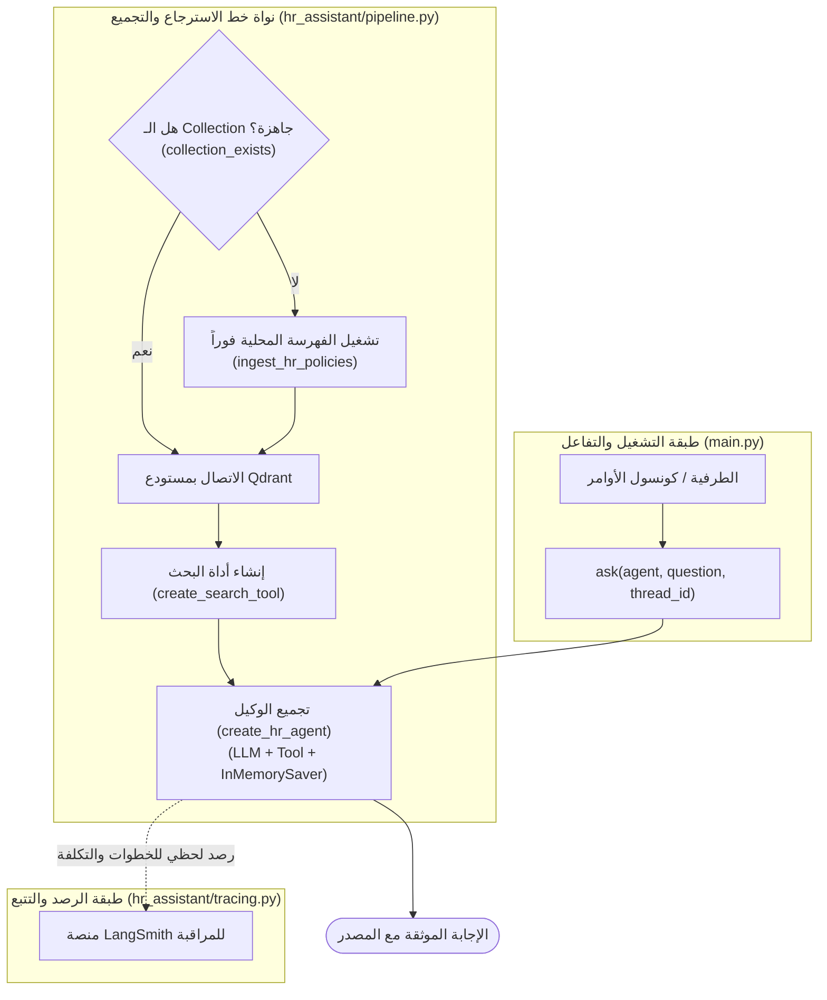

# تكامل خط الاسترجاع الشامل وتطبيق الكونسول
# (End-to-End Retrieval Pipeline, Tracing & CLI Demo)

---

## 1. المدخل المعماري: ربط منظومة الـ Agentic RAG في واجهة موحدة

بعد بناء المكونات الفردية للنظام (قاعدة متجهات Qdrant، محرك إعادة الترتيب Cross-Encoder، النموذج اللغوي Gemini، ووكيل LangGraph)، تتكامل هذه المنظومة في هذه المرحلة عبر خط تجميعي موحد (`Pipeline`) يوفر نقطة دخول برمجية واحدة تدير:
1. فحص وضبط التتبع والمراقبة السحابية (`Observability via LangSmith`).
2. الإقلاع الذاتي الآمن لقاعدة البيانات وفهرستها محلياً إن لم تكن متوفرة (`Self-healing Bootstrap`).
3. توفير واجهة استدعاء تفاعلية تدعم الذاكرة وتعدد الجلسات (`Unified ask() Method`).
4. واجهة تشغيل تجريبية تفاعلية عبر الطرفية (`main.py`).

---

## 2. تشريح المكونات المضافة

### أ. وحدة فحص الرصد والتتبع (`hr_assistant/tracing.py`)
* تعتمد مكتبة LangChain على متغيرات البيئة الأساسية (`LANGSMITH_TRACING`, `LANGSMITH_API_KEY`, `LANGSMITH_PROJECT`).
* وظيفة الوحدة فحص هذه المتغيرات وتسجيل حالة التتبع عند الإقلاع دون إيقاف التطبيق في حال عدم تفعيل الخدمة، مما يمنح المطور رؤية واضحة لحالة النظام مع الحفاظ على استمرارية التشغيل.

### ب. نواة خط الربط الشامل (`hr_assistant/pipeline.py`)
يتضمن الملف ثلاث وظائف محورية:
1. **دالة الإقلاع الذاتي (`_bootstrap_collection`):**
   * تتحقق من وجود الـ Collection في Qdrant قبل بدء المحادثة.
   * في حال تشغيل التطبيق لأول مرة على بيئة جديدة، تستدعي الفهرسة المحلية مباشرة لتجهيز المقاطع دون أي اعتماد على خدمات التخزين السحابي المدفوعة (Zero-Cost Local First).
2. **دالة بناء المساعد (`build_hr_assistant`):**
   * تفحص صلاحية المفاتيح البرمجية (`check_api_keys`).
   * تنشئ مخزن الذاكرة اللحظية للجلسة (`InMemorySaver`).
   * تجمع بين النموذج اللغوي ومستودع المتجهات داخل وكيل LangGraph التنفيذي.
3. **واجهة الاستعلام الموحدة (`ask`):**
   * تستقبل السؤال ومعرف الجلسة (`thread_id`).
   * تمرر المحادثة إلى الوكيل وتستخرج الإجابة النصية الصافية بدقة وموثوقية عبر معالجة هياكل الرد المختلفة في النماذج الحديثة.

### ج. واجهة التشغيل التجريبية (`main.py`)
* نقطة انطلاق معيارية لتشغيل المساعد عبر سطر الأوامر.
* تختبر سلوك الوكيل وقدرته على استرجاع لوائح الموارد البشرية من خلال 5 استعلامات أساسية تغطي:
  * الإجازات السنوية ومعدل استحقاقها (`leave_policy.txt`).
  * فترة الإنذار أثناء فترة التجربة (`probation_policy.txt`).
  * ضوابط وسياسات العمل عن بُعد (`work_from_home_policy.txt`).
  * مصير الإجازات أثناء فترة الإنذار (`notice_period_policy.txt`).
  * استحقاق إجازات الأمومة ورعاية الأطفال (`maternity_paternity_policy.txt`).

---

## 3. التحقق العملي والمخرجات القياسية

عند تنفيذ الأمر `python main.py`، يسير النظام بالترتيب التالي:
1. تسجيل حالة تتبع LangSmith.
2. التحقق من اتصال Qdrant Cloud ووجود الـ 68 مقطعاً المفهرسة.
3. إقلاع نموذج FastEmbed المحلي لتوليد التضمينات الدلالية واستخراج المرشحين.
4. إعادة ترتيب المقاطع عبر الـ Re-ranker لاختيار أفضل 5 نتائج.
5. استدعاء النموذج اللغوي لتوليد الإجابة النهائية مع توثيق المصادر الدقيقة بدقة استدلال كاملة وفي زمن استجابة يتراوح بين 3 و 4 ثوانٍ لكل استعلام.
