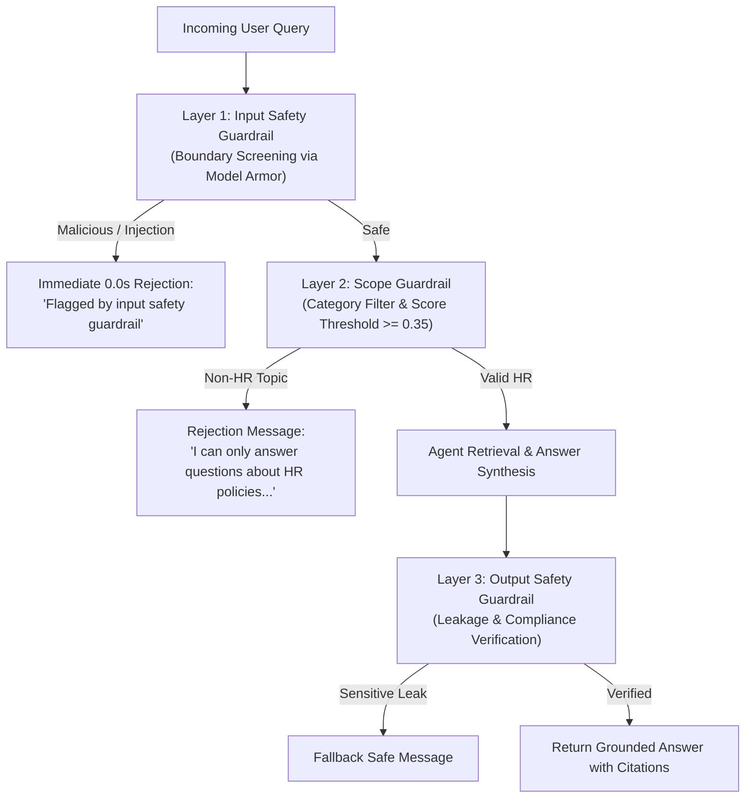

# AI Security & Guardrails: Defense-in-Depth Boundary Architecture

## 1. Threat Model & Adversarial Attack Vectors

Enterprise conversational assistants operating over internal corporate documents face distinct security threats:
1. **Direct Prompt Injection**: Overriding model system prompts (e.g. *"Ignore all previous instructions..."*).
2. **Jailbreaking & Persona Reassignment**: Tricking the agent into assuming an unconstrained persona (e.g. DAN attacks, helpful chef, fictional roleplay).
3. **Domain & Scope Escape**: Attempting to extract confidential non-HR corporate information (e.g. querying finance revenue or executive salaries).
4. **Data Exfiltration**: Inducing the model to reveal internal tool signatures, environment keys, or system prompts verbatim.

---

## 2. Multi-Layer Guardrail Architecture

The security subsystem (`src/security/guardrails.py` & `src/agent/tools.py`) implements a **Three-Tier Boundary**:



---

## 3. Implementation Details

### Layer 1: Input Safety Screening (`check_input`)
The input screening function analyzes not only the active prompt, but also the preceding 6 turns of conversation history (`src/agent/thread_memory.py`). This neutralizes **multi-turn split jailbreaks**:
```python
def check_input(text: str) -> Tuple[bool, str]:
    """Screen user query and multi-turn context against prompt injection and persona breaks."""
    # Automated heuristic patterns and Google Model Armor inspection
    ...
```

### Layer 2: Scope Fencing (`src/agent/tools.py`)
Queries for documents outside the 10 approved HR categories (`Leave`, `Work From Home`, `Probation`, `Notice Period`, `Reimbursement`, `Code of Conduct`, `Holidays`, `Maternity Paternity`, `Travel Expense`, `Exit Process`) are rejected:
```python
if chunk_category not in settings.HR_POLICY_CATEGORIES:
    continue  # Exclude non-HR noise
```

### Layer 3: Output Safety Screening (`check_output`)
Before writing an answer to cache or transmitting it to the client, the output guardrail verifies that system instructions, hidden keys, or toxic terms are not present in the generated text.
