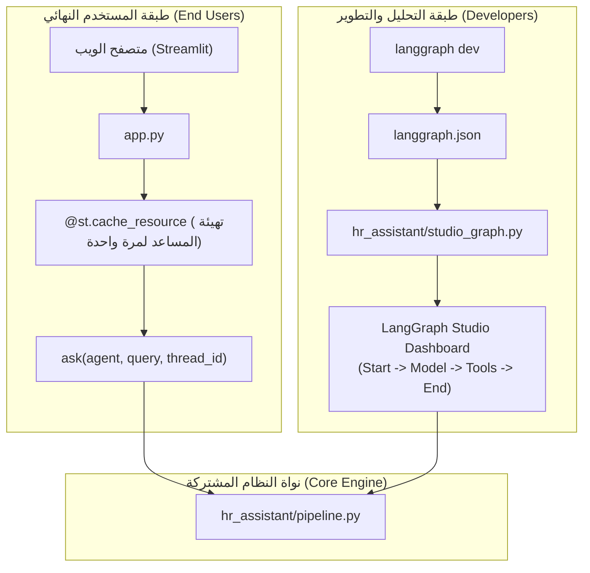

# واجهة المحادثة التفاعلية وبيئة الرصد البصري LangGraph Studio
# (Streamlit Web UI & LangGraph Studio Visualization)

---

## 1. المدخل المعماري: الانتقال من الكونسول إلى واجهات الاستخدام والرصد

بعد إتمام خط الاسترجاع والتوليد واختباره برمجياً، تكتمل المرحلة الأولى من المشروع ببناء واجهتين متكاملتين:
1. **واجهة المستخدم التفاعلية (`app.py` عبر Streamlit):** واجهة ويب احترافية مخصصة للموظفين وإدارة الموارد البشرية مع إدارة مرنة للذاكرة والجلسات وأسئلة سريعة جاهزة.
2. **بيئة الرصد والتحليل البصري (`LangGraph Studio` عبر `langgraph dev`):** بيئة تطوير متقدمة للمطورين تتيح رؤية شجرة القرارات ومسار الانتقال بين العقد (Nodes) والأدوات (Tools) بشكل مرئي ولحظي.

---

## 2. تشريح المكونات المضافة

### أ. واجهة المستخدم التفاعلية (`app.py`)
* **عزل الجلسات (`Session Isolation`):** يتم توليد معرف فريد `uuid.uuid4()` لكل جلسة تصفح، مما يضمن احتفاظ كل مستخدم بسياق محادثته دون تداخل مع مستخدمين آخرين.
* **الأداء السريع عبر الـ Caching:** استخدام وسم `@st.cache_resource` لتهيئة الـ Agent والاتصال بـ Qdrant لمرة واحدة فقط عند إقلاع السيرفر، وتفادي إعادة الاتصال مع كل رسالة جديدة.
* **بطاقات الأسئلة السريعة (Quick Questions):** تسهيل تجربة المساعد بأسئلة جاهزة في الشريط الجانبي (Sidebar).
* **إدارة الحالة ومسح الذاكرة (`Reset / New Conversation`):** توفير زر صريح لتصفير سجل المحادثة وتوليد معرف جلسة جديد.

### ب. تكوين بيئة LangGraph Studio (`langgraph.json` & `studio_graph.py`)
* **`langgraph.json`:** ملف الإعدادات الرسمي الذي يحدد مسارات المشروع، ومصدر الرسم البياني المترجم (`graphs: hr_agent`)، وملف البيئة `.env`.
* **`hr_assistant/studio_graph.py`:** مصدّر الكائن التنفيذي للرسم البياني. 
  * تم ضبطه ليمرر `checkpointer=False` لكون منصة `LangGraph Studio` تدير آلية الحفظ وحفظ نقاط التفتيش (Persistence & Checkpoints) تلقائياً على خوادمها، وتتعارض مع وجود `InMemorySaver` مدمج داخل كود الوكيل.

---

## 3. سيناريوهات الاختبار والنتائج العملية

تم إخضاع المساعد لحزمة اختبارات شملت كافة السيناريوهات الحافة (Edge Cases):
1. **الاسترجاع المباشر والأرقام الدقيقة:** استخراج بدل الإنترنت (1,500 شهرياً) وبدل السفر وقواعد العطلات من لوائحها المحددة بدقة كاملة.
2. **اختبار الذاكرة متعددة الأدوار (Conversational Multi-Turn):** فهم الضمائر والاستفسارات التابعة دون تكرار اسم الموضوع.
3. **توليف لوائح متعددة (Cross-Policy Synthesis):** الإجابة عن استقالة الموظف خلال فترة التجربة بدمج 3 لوائح مختلفة (`Probation`, `Notice Period`, `Exit Process`).
4. **مقاومة التشتت والملفات المشوشة:** الرفض الصارم للأسئلة المالية المتعلقة بأرباح الربع الثالث وعدم الخلط بينها وبين لوائح الموارد البشرية.
5. **مكافحة الهلوسة (Grounded Negative Rejection):** التأكيد الواضح على عدم تغطية اشتراكات الجيم في اللائحة بناءً على البنود الرسمية.
