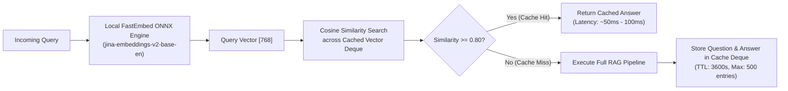

# Semantic Caching & Memory: ONNX Acceleration & Session Persistence

## 1. High-Frequency Query Optimization via Semantic Caching

In enterprise HR departments, over $60\%$ of employee inquiries are repetitive variations of the same underlying questions (e.g. *"How many paid annual leave days do I get?"* vs *"How many days of annual vacation do I receive?"*).

Sending every query to a frontier LLM incurs high financial cost and adds several seconds of latency. The system implements an **In-Memory Semantic Cache** (`src/security/semantic_cache.py`) that matches queries using dense vector cosine similarity:

---

## 2. Cosine Similarity & Bounded Eviction

The cosine similarity between the incoming query vector $\mathbf{u}$ and a cached question vector $\mathbf{v}$ is evaluated:

$$
\text{sim}(\mathbf{u}, \mathbf{v}) = \frac{\mathbf{u} \cdot \mathbf{v}}{\|\mathbf{u}\|_2 \|\mathbf{v}\|_2}
$$

If $\max_{\mathbf{v} \in \mathcal{C}} \text{sim}(\mathbf{u}, \mathbf{v}) \ge \theta_{\text{cache}} = 0.80$, the system delivers the cached response immediately.

### Capacity & TTL Management:
- **Max Entries**: 500 records bounded via `collections.deque`.
- **Time-to-Live (TTL)**: 3600 seconds (1 hour). Expired entries are automatically evicted upon fresh lookup.

---

## 3. Multi-Turn Conversational Memory (`src/agent/thread_memory.py`)

To support multi-turn dialogue (e.g. *"What is the standard probation period?"* followed by *"Can it be extended, and for how long?"*), conversation history is persisted using LangGraph checkpointers:

- **State Management**: Each session is keyed by a unique `thread_id`.
- **Cache Hit Continuity**: When a query hits the semantic cache, `thread_memory.record_turn()` updates the agent's internal state with the cached interaction, ensuring subsequent conversational turns retain full context.
- **Safety Neutralization**: Hostile prompt injections blocked by input guardrails are deliberately omitted from state memory, preventing toxic prompts from poisoning the agent's dialogue context.
