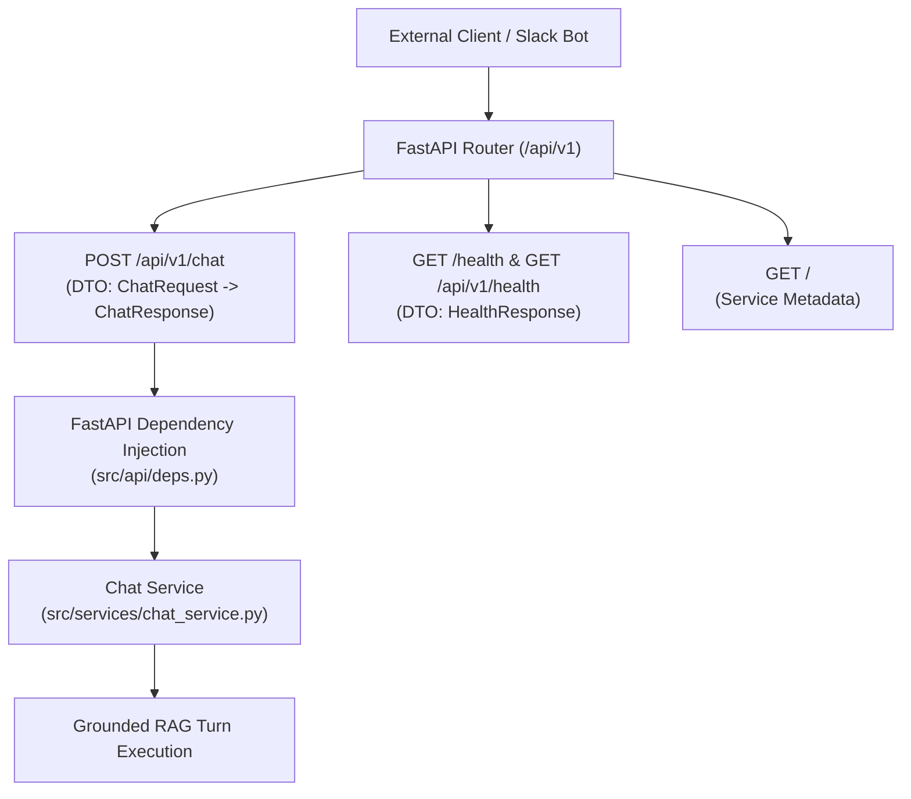

# Production REST API & Schemas: FastAPI & Pydantic v2 DTOs

## 1. REST API Architecture

To support programmatic enterprise integration with Slack bots, Microsoft Teams, custom internal dashboards, and external microservices, the system exposes a high-throughput **FastAPI REST API** (`src/main.py`).



---

## 2. Strict Pydantic v2 Data Transfer Objects (DTOs)

All payload contracts are strictly enforced using Pydantic v2 models defined in `src/schemas/`:

### Chat Request DTO (`src/schemas/chat.py`):
```python
class ChatRequest(BaseModel):
    """Incoming user query payload."""
    query: str = Field(
        ...,
        min_length=1,
        max_length=2000,
        description="The employee's inquiry regarding company HR policy.",
        examples=["How many days of paid annual leave do I get?"],
    )
    thread_id: Optional[str] = Field(
        default=None,
        description="Optional session/thread identifier for multi-turn conversational memory.",
        examples=["user-session-1234"],
    )
```

### Chat Response DTO (`src/schemas/chat.py`):
```python
class Citation(BaseModel):
    """Document citation supporting an assistant answer."""
    source: str = Field(..., description="Filename or category of cited policy.")
    content_snippet: Optional[str] = Field(default=None)
    score: Optional[float] = Field(default=None, ge=0.0, le=1.0)

class ChatResponse(BaseModel):
    """Validated structured response from the HR Policy Assistant."""
    answer: str = Field(..., description="Grounded response text citing sources.")
    thread_id: str = Field(..., description="Active thread session identifier.")
    is_cached: bool = Field(default=False, description="Resolved directly via Semantic Cache.")
    latency_seconds: float = Field(default=0.0, ge=0.0, description="Execution latency.")
    citations: List[Citation] = Field(default_factory=list, description="Referenced documents.")
```

### Health Diagnostics DTO (`src/schemas/health.py`):
```python
class ComponentStatus(BaseModel):
    name: str
    status: Literal["healthy", "degraded", "unreachable"]
    details: Optional[str] = None

class HealthResponse(BaseModel):
    status: Literal["healthy", "degraded", "unhealthy"]
    version: str = "1.0.0"
    components: List[ComponentStatus]
```

---

## 3. Endpoints Specification

### 1. `POST /api/v1/chat`
- **Purpose**: Execute grounded RAG against HR policies with guardrails and semantic caching.
- **Sample Request**:
  ```bash
  curl -X POST "http://localhost:8000/api/v1/chat" \
       -H "Content-Type: application/json" \
       -d '{"query": "What is the standard probation period?", "thread_id": "session-101"}'
  ```
- **Sample Response**:
  ```json
  {
    "answer": "The standard probation period for all new full-time employees is 3 months (90 calendar days) from their date of joining. (Source: probation_policy.txt)",
    "thread_id": "session-101",
    "is_cached": false,
    "latency_seconds": 6.84,
    "citations": [
      {
        "source": "probation_policy.txt",
        "content_snippet": null,
        "score": null
      }
    ]
  }
  ```

### 2. `GET /health` & `GET /api/v1/health`
- **Purpose**: Kubernetes liveness/readiness probe validating Qdrant Cloud, LLM gateway, and cache status.
- **Sample Response**:
  ```json
  {
    "status": "healthy",
    "version": "1.0.0",
    "components": [
      {
        "name": "qdrant_cloud",
        "status": "healthy",
        "details": "Collection: hr_policies"
      },
      {
        "name": "llm_gateway",
        "status": "healthy",
        "details": "Primary: gemini-3.5-flash-lite"
      },
      {
        "name": "semantic_cache",
        "status": "healthy",
        "details": "Threshold: 0.8"
      }
    ]
  }
  ```

### 3. Interactive Documentation:
- **Swagger UI**: Available at `http://localhost:8000/docs`
- **ReDoc**: Available at `http://localhost:8000/redoc`
- **OpenAPI Schema**: Available at `http://localhost:8000/openapi.json`
