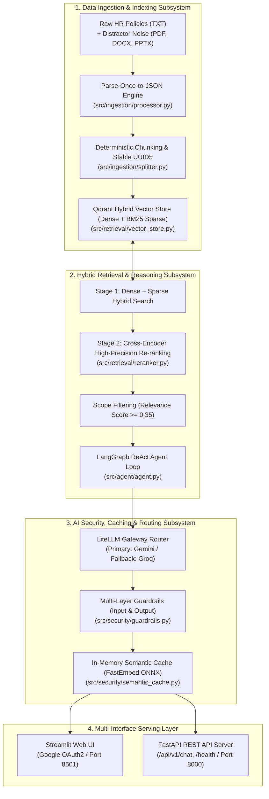

# HR Policy RAG Assistant: Engineering & Architecture Manual

Welcome to the **Engineering Architecture Manual and Technical Documentation** for the **HR Policy RAG Assistant with Enterprise AI Security**. 

This system serves as an enterprise reference implementation of a production-grade, secure, cloud-native Retrieval-Augmented Generation (RAG) assistant designed for corporate environments.

---

## 1. System Architecture Map (Documentation Index)

The documentation is organized into 15 sequential modules reflecting the end-to-end lifecycle of the system:

| Module | Technical Topic | Reference Guide (`docs/`) | Status |
| :---: | :--- | :--- | :---: |
| **01** | Executive Summary, Production Standards & DDD Layout | [`01-system-overview.md`](./01-system-overview.md) | Completed |
| **02** | System Architecture & Domain-Driven Modular Layout | [`02-system-architecture.md`](./02-system-architecture.md) | Completed |
| **03** | Enterprise Corpus Design & Distractor Noise Strategy | [`03-data-strategy.md`](./03-data-strategy.md) | Completed |
| **04** | Configuration Guide & Pydantic v2 BaseSettings | [`04-configuration-guide.md`](./04-configuration-guide.md) | Completed |
| **05** | Document Processing & Parse-Once-to-JSON Pattern | [`05-document-processing.md`](./05-document-processing.md) | Completed |
| **06** | Semantic Chunking, Stable UUID5 & Qdrant Hybrid Index | [`06-chunking-and-vector-store.md`](./06-chunking-and-vector-store.md) | Completed |
| **07** | SOLID Ingestion Orchestration & Ingestion CLI | [`07-ingestion-pipeline.md`](./07-ingestion-pipeline.md) | Completed |
| **08** | Hybrid Retrieval Fusion, Cross-Encoder & ReAct Agent | [`08-retrieval-and-agent-pipeline.md`](./08-retrieval-and-agent-pipeline.md) | Completed |
| **09** | LiteLLM Gateway Router & Dynamic Model Failover | [`09-llm-gateway-and-routing.md`](./09-llm-gateway-and-routing.md) | Completed |
| **10** | AI Security & Multi-Layer Boundary Guardrails | [`10-ai-security-and-guardrails.md`](./10-ai-security-and-guardrails.md) | Completed |
| **11** | Semantic Caching (ONNX FastEmbed) & Thread Memory | [`11-semantic-caching-and-memory.md`](./11-semantic-caching-and-memory.md) | Completed |
| **12** | Adversarial Red Teaming & RAG Triad Evaluation | [`12-red-teaming-and-evaluation.md`](./12-red-teaming-and-evaluation.md) | Completed |
| **13** | Streamlit Web User Interface & AppTest Integration | [`13-web-ui-and-testing.md`](./13-web-ui-and-testing.md) | Completed |
| **14** | Production Containerization, Docker Compose & Google IAM | [`14-containerization-and-iam.md`](./14-containerization-and-iam.md) | Completed |
| **15** | Production FastAPI REST API & Strict Pydantic DTOs | [`15-production-rest-api.md`](./15-production-rest-api.md) | Completed |

---

## 2. Architectural Pillars

---

## 3. Technology Stack Summary

- **Orchestration**: LangGraph, LangChain Core, Python 3.12 / 3.11
- **LLM Gateway & Inference**: LiteLLM Router, Google Gemini 3.5 Flash-Lite, Groq LPU (GPT-OSS-20B / Llama 3.3)
- **Vector Database**: Qdrant Cloud (Hybrid Dense + Sparse Storage)
- **Embeddings & Re-ranking**: FastEmbed (BM25 sparse & ONNX dense runtime), Jina AI Embeddings v2, Jina Cross-Encoder Reranker v2
- **Document Extractors**: `pypdf`, `python-docx`, `python-pptx`
- **Application Services & API**: FastAPI, Uvicorn, Pydantic v2, Pydantic-Settings
- **Frontend & Auth**: Streamlit, Authlib, Google OAuth 2.0
- **Observability & Testing**: LangSmith Tracing, Streamlit AppTest, Python unittest (53 automated tests)
- **Containerization**: Docker, Docker Compose, Google Cloud Run
