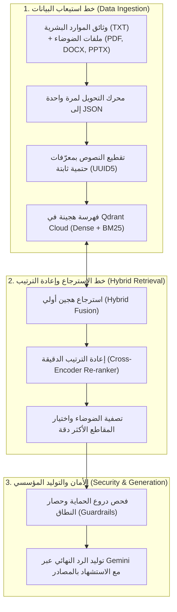

# التوثيق الهندسي والمعماري لمشروع مساعد سياسات الموارد البشرية
# (HR Policy RAG Assistant with Enterprise AI Security — Architecture Manual)

مرحباً بك في الدليل المعماري والمواصفات الهندسية الشاملة لنظام **مساعد سياسات الموارد البشرية المؤمن للشركات** (`HR Policy RAG Assistant with Enterprise AI Security`). تم تصميم هذا النظام كمرجع إنتاجي متكامل (`Production Reference Implementation`) يجمع بين الاسترجاع الهجين عالي الدقة، ودروع الحماية السيبرانية للذكاء الاصطناعي، والحاويات السحابية الموزعة.

---

## 1. الفهرس المعماري لوثائق النظام (System Architecture Map)

تنقسم وثائق المشروع الهندسية إلى موديولات متسلسلة تعكس دورة حياة النظام:

| الموديول | موضوع الوثيقة الهندسية | الرابط المرجعي (`docs/`) | الحالة |
| :---: | :--- | :--- | :---: |
| **01** | نظرة عامة على النظام والمعايير المؤسسية للإنتاج | [`01-system-overview.md`](./01-system-overview.md) | مكتمل |
| **02** | المعمارية الهندسية ثلاثية الأطوار والطبقات | [`02-system-architecture.md`](./02-system-architecture.md) | مكتمل |
| **03** | استراتيجية البيانات وتصميم مسار الضوضاء | [`03-data-strategy.md`](./03-data-strategy.md) | مكتمل |
| **04** | إدارة الإعدادات المركزية والبيئة الآمنة | [`04-configuration-guide.md`](./04-configuration-guide.md) | مكتمل |
| **05** | محرك معالجة الوثائق والصيغ المتعددة ونمط الـ JSON | [`05-document-processing.md`](./05-document-processing.md) | مكتمل |
| **06** | التقطيع الدلالي والتخزين المتجهي الهجين في Qdrant | [`06-chunking-and-vector-store.md`](./06-chunking-and-vector-store.md) | مكتمل |
| **07** | أتمتة خط الإدخال بمعايير SOLID وتشغيل الـ CLI | [`07-ingestion-pipeline.md`](./07-ingestion-pipeline.md) | مكتمل |
| **08** | محرك الاسترجاع وإعادة الترتيب ووكيل المساعد (`RAG Agent`) | [`08-retrieval-and-agent-pipeline.md`](./08-retrieval-and-agent-pipeline.md) | مكتمل |
| **09** | خط أنابيب الاستعلام التفاعلي وواجهة المحادثة (`Query Pipeline`) | قريباً | قيد التطوير |
| **10** | بوابة النماذج الذاتية ودروع الحماية (`AI Security & Guardrails`) | قريباً | الطور الثاني |
| **11** | اختبارات الاختراق والفريق الأحمر (`Red Teaming`) | قريباً | الطور الثاني |
| **12** | النشر السحابي الكامل عبر Docker و Cloud Run | قريباً | الطور الثالث |

---

## 2. الركائز المعمارية للنظام (Architectural Pillars)

---

## 3. الأهداف الهندسية والعملية للمشروع

1. **التعامل مع بيئات البيانات المشوشة (`Noisy Enterprise Databases`):**
   * عزل وثائق الـ HR عن الضوضاء المؤسسية غير ذات الصلة (تقارير المبيعات، عروض العمليات، استراتيجيات التسويق) بالاعتماد على نماذج `Cross-Encoder`.
2. **معمارية محلية مجانية بالكامل (`Local-First Zero-Cost Architecture`):**
   * إمكانية تشغيل النظام واختباره وتطويره بالكامل دون تكاليف بنكية أو حاجة لفوترة سحابية إلزامية عبر Google Cloud Storage، مع الحفاظ على التوافق الكامل مع التوزيعات السحابية.
3. **تطبيق دروع الحماية ومكافحة الهلوسة (`Zero-Hallucination & AI Security`):**
   * إجبار النموذج على الاستشهاد الصريح باسم الوثيقة المصدرية ورقم المادة، ورفض الإجابة عند عدم العثور على المعلومة، وصد هجمات حقن التعليمات (`Prompt Injection`).
4. **التخزين الهجين الحتمي (`Deterministic Upsert & Hybrid Search`):**
   * منع تكرار البيانات داخل قاعدة المتجهات عبر المعرفات الحتمية `UUID5`، والجمع بين الفهم الدلالي (`Jina Embeddings`) والتطابق الحرفي للمصطلحات الإدارية (`BM25`).
